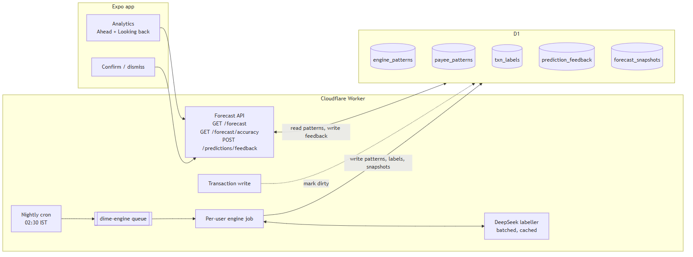
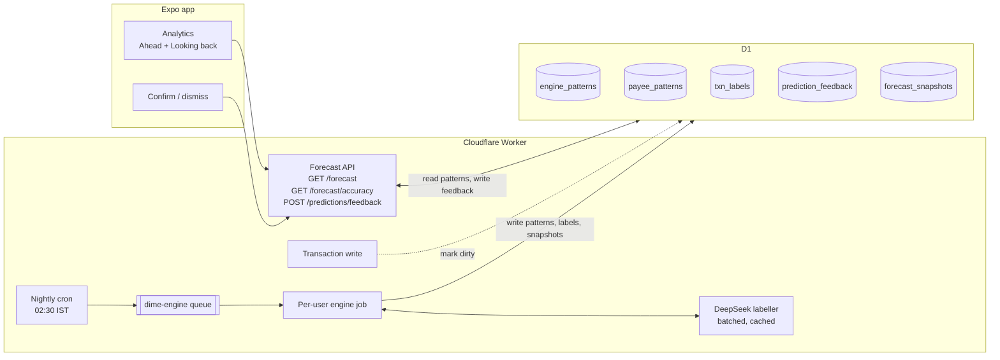

# Dime predictive engine: plan

Status: design approved in chat, 2026-10-22. Not started.

Goal: Analytics should look **ahead**, not only back. A per-user engine learns each person's spending patterns from their own history and predicts where the month will land, what's coming up and what to watch. It gets better from feedback and from scoring its own past forecasts.

## 1. Principles

- **Statistics first, ML later.** Each person has a few hundred transactions, which is too little to train models on. Simple, robust statistics on their own history (medians, weekday profiles, cadences) are accurate and explainable. A trained model has to *beat* this engine on real Dime data before it ships (v4).
- **Code computes, DeepSeek explains.** No number shown to the user comes from an LLM. DeepSeek labels things (one-off or habit, subscription or habit, payee merges) and writes the sentences. Numbers are put into those sentences by code.
- **Honest uncertainty.** Forecasts are ranges (p10–p90) with a "chance of staying under budget", and the engine reports how accurate it was last month.
- **Graceful degradation.** Too little history uses the budget-only fallback. DeepSeek being down or over budget uses template text. A failed nightly job means the last good patterns are used.
- **$5/month budget.** SQL aggregates on D1, one nightly queue job per active user, cached LLM labels, and no new paid services.

## 2. Versions at a glance

| Version | Features | Surfaces |
|---|---|---|
| **v1** | Pattern store, month-end forecast as a range, safe to spend today, forecast per category, Coming up (bills, likely spends, income), Watch (running-hot categories, unusual spends, subscriptions not yet tracked), confirm/dismiss feedback, self-scoring, new-user fallback, DeepSeek labelling and one-line explanations including the daily summary | Analytics redesign: "Ahead" + "Looking back" |
| **v2** | Agent tools on the engine (`get_forecast`, `get_patterns`, `what_if`), Clairic as a second opinion on the forecast range, scored against ours | Agent chat, Analytics accuracy line |
| **v3** | Proactive nudges (bill tomorrow, low safe-to-spend before a heavy weekend, category running hot), only once accuracy is proven | Push and in-app notifications, Settings switches |
| **v4** | ML learning track: offline notebook, LightGBM global model on Dime data, export to JSON trees run in the Worker, ships only if it beats v1 in backtests | `ml/` workspace; engine picks the best method per user |

## 3. Architecture



<details>
<summary>Diagram source (Mermaid). Re-render with <code>mmdc -i docs/images/predictive-engine-architecture.mmd -o docs/images/predictive-engine-architecture.png -s 2</code></summary>



</details>

**Two-stage design:**
1. **Patterns (slow, nightly):** heavy aggregation over the last 120 days, plus DeepSeek labelling, produces a compact per-user profile in `engine_patterns` and `payee_patterns`. It also runs on demand when a user is marked dirty and opens Analytics, with at most one recompute every 15 minutes.
2. **Forecast (fast, per request):** the profile plus this month's transactions plus budgets plus recurring items, computed in TypeScript on each `GET /forecast` request. It's cheap (one small SQL read and microseconds of maths) and always reflects the latest transaction.

New code lives in `api/src/features/engine/`:

| File | Purpose |
|---|---|
| `patterns.ts` | SQL aggregates, then the profile (weekday baselines, category baselines, payday) |
| `cadence.ts` | Payee cadence detection, subscription candidates, next expected date |
| `forecast.ts` | Month-end range, chance under budget, safe to spend, per category |
| `upcoming.ts` | Next 14 days: bills, likely spends, income |
| `watch.ts` | Running-hot categories, unusual spends, subscriptions not yet tracked |
| `confidence.ts` | Beta(α, β) confidence per prediction, feedback updates |
| `scoring.ts` | Snapshots, month-end evaluation, per-user tuning |
| `labeller.ts` | DeepSeek batch labelling and explanations, cache, budget, templates |
| `job.ts` | Queue consumer: one user's nightly run |
| `routes.ts` / `schemas.ts` | Hono routes and Zod contracts |

## 4. Data model (migration `0010_engine.sql`)

```sql
-- One profile row per user, rebuilt nightly. JSON keeps the schema stable while the model evolves.
CREATE TABLE engine_patterns (
  user_id       TEXT PRIMARY KEY REFERENCES users (id) ON DELETE CASCADE,
  version       INTEGER NOT NULL,            -- profile format version
  history_days  INTEGER NOT NULL,            -- usable days of history
  profile       TEXT NOT NULL,               -- JSON: weekday baselines, category baselines, payday, tuning
  dirty         INTEGER NOT NULL DEFAULT 0,  -- set on transaction write
  computed_at   TEXT NOT NULL
);

-- One row per user + payee with enough repeats to have a cadence.
CREATE TABLE payee_patterns (
  user_id          TEXT NOT NULL REFERENCES users (id) ON DELETE CASCADE,
  payee_key        TEXT NOT NULL,
  display_name     TEXT NOT NULL,
  kind             TEXT NOT NULL CHECK (kind IN ('habit', 'subscription', 'income', 'unknown')),
  category_id      TEXT,
  count_120d       INTEGER NOT NULL,
  median_amount    INTEGER NOT NULL,         -- paise
  median_interval_days REAL,
  interval_cv      REAL,                     -- regularity: lower = more regular
  last_at          TEXT NOT NULL,
  next_expected_at TEXT,
  alpha            REAL NOT NULL DEFAULT 1,  -- Beta confidence (hits + prior)
  beta             REAL NOT NULL DEFAULT 1,  -- (misses + prior)
  suppressed       INTEGER NOT NULL DEFAULT 0,
  PRIMARY KEY (user_id, payee_key)
);

-- LLM labels per transaction (one-off vs habit) and per payee merge. Computed once, cached forever.
CREATE TABLE txn_labels (
  transaction_id TEXT PRIMARY KEY REFERENCES transactions (id) ON DELETE CASCADE,
  user_id        TEXT NOT NULL,
  one_off        INTEGER NOT NULL CHECK (one_off IN (0, 1)),
  source         TEXT NOT NULL CHECK (source IN ('llm', 'rule', 'user')),
  labelled_at    TEXT NOT NULL
);

-- What the user told us about a prediction.
CREATE TABLE prediction_feedback (
  id           TEXT PRIMARY KEY,
  user_id      TEXT NOT NULL REFERENCES users (id) ON DELETE CASCADE,
  target_kind  TEXT NOT NULL CHECK (target_kind IN ('payee', 'subscription_candidate', 'unusual_txn', 'category_watch')),
  target_id    TEXT NOT NULL,             -- payee_key / transaction id / category id
  verdict      TEXT NOT NULL CHECK (verdict IN ('confirm', 'dismiss', 'not_one_off', 'one_off')),
  created_at   TEXT NOT NULL
);

-- Forecasts as they were made, for self-scoring.
CREATE TABLE forecast_snapshots (
  user_id     TEXT NOT NULL REFERENCES users (id) ON DELETE CASCADE,
  month       TEXT NOT NULL,              -- 'YYYY-MM'
  day         INTEGER NOT NULL,           -- day of month the forecast was made
  method      TEXT NOT NULL,              -- 'stats' (v1), 'clairic' (v2), 'gbm' (v4)
  p10 INTEGER NOT NULL, p50 INTEGER NOT NULL, p90 INTEGER NOT NULL,
  actual      INTEGER,                    -- filled at month end
  PRIMARY KEY (user_id, month, day, method)
);
```

Money stays in integer paise, as everywhere in D1.

## 5. Algorithms (v1)

All windows use the user's timezone (the same source as `recurring_items.timezone`). "Flexible" spend = debits **minus** recurring-posted bills, self transfers and anything labelled one-off.

### 5.1 Baselines (nightly, `patterns.ts`)
- **Window:** last 90 days by default, tuned per user to 60, 90 or 120 days by self-scoring (§6.2).
- **Weekday profile:** for each weekday, the daily flexible totals (including zero days), giving the median and the full list of values (kept for resampling). Recent weeks get more weight through recency-weighted resampling with a half-life of 30 days.
- **Category baselines:** monthly flexible totals per category over the window, giving the median and MAD (median absolute deviation).
- **Payday:** the most common day of month of the largest recurring credit, from income recurring items first, then cadence-detected credits.

### 5.2 Month-end forecast (`forecast.ts`, per request)
- `landing = spent_so_far + bills_still_due + flexible_remaining`
- `bills_still_due` = active recurring subscriptions with `next_due_date` in the rest of the month, plus confirmed subscription patterns not yet posted.
- `flexible_remaining`: **resample** remaining days by drawing each one from the same weekday's history. Run 1,000 draws and take p10, p50 and p90. This gives an honest range with no distribution assumptions. Ranges are widened by the per-user `width_factor` from self-scoring.
- **Chance under budget** = the share of draws with `landing ≤ monthly_budget`.
- **Per category:** the same resampling on category-level daily series, compared with the category budget if there is one, otherwise with the category baseline.

### 5.3 Safe to spend today
- `safe_today = max(0, budget − spent − bills_still_due) × w_today / Σ w_remaining_days`, where `w_d` is the weekday median weight. Heavy days get more, quiet days less.
- With no budget, show "Usual for a {weekday}: ₹X" instead.

### 5.4 Payee cadence and subscriptions (`cadence.ts`)
- Payees with **≥3** debits in 120 days get the intervals between them, giving the median interval and `interval_cv`.
- **Habit:** `interval_cv ≤ 0.6`. Next expected = `last_at + median_interval`. It appears in Coming up when it falls within the next 14 days and confidence is ≥ 0.6.
- **Subscription candidate:** interval 28–31 days (or 365 ± 7), amount CV ≤ 10%, and not already a recurring item. DeepSeek confirms subscription vs habit once per payee (§7). It's offered as "Track as recurring?"
- **Income:** the same logic on credits, which gives expected income dates.

### 5.5 Watch list (`watch.ts`)
- **Running hot:** the category's p50 landing is above its budget, or above its baseline by ≥ 25% *and* ≥ ₹500. The driver is the payee or weekday contributing the most to the excess.
- **Unusual spend:** robust z-score = `(amount − median) / (1.4826 × MAD)` against the payee, falling back to the category. Flagged when z ≥ 3.5 and there are ≥ 5 past samples. The flag is shown for 7 days.
- **Untracked subscriptions:** candidates from §5.4 that haven't been dismissed.

### 5.6 New users and sparse data
- **< 14 days of history:** budget-only forecast (straight line plus bills) and a "Learning your patterns (n of 30 days)" label. No likely spends or unusual flags.
- **14–30 days:** the forecast uses the weekday profile, falling back to the overall daily median for weekdays with fewer than 2 samples. Ranges are widened 1.5×.
- **≥ 30 days:** all features.

## 6. Learning

### 6.1 Confidence and feedback (`confidence.ts`)
- Every repeating-payee prediction has a confidence of Beta(α, β), with a mean of `α/(α+β)` and a prior of Beta(2, 1) for regular cadences.
- **Implicit:** a predicted spend that happens within ±2 days of the expected date adds 1 to α (a hit). A missed window adds 1 to β (a miss).
- **Explicit:**
  - Confirm adds 3 to α.
  - Dismiss sets `suppressed = 1`.
  - "Not a subscription" changes the kind to habit.
  - "Not unusual" or "one-off" writes a `txn_labels` row with source `user`, which overrides the LLM.
- Below 0.4 confidence the prediction is hidden, and it comes back if hits return.

### 6.2 Self-scoring (`scoring.ts`)
- The nightly job saves a snapshot on days 7, 14 and 21 (and day 1 for the month-start forecast).
- On the 1st, the previous month's `actual` is filled in. The job then computes:
  - **Error:** `|p50 − actual| / actual`.
  - **Coverage:** whether the actual fell inside p10–p90.
- **Tuning, after ≥ 2 scored months:**
  - If coverage < 70%, raise `width_factor` by 10%. If > 90% with a narrow error, lower it.
  - Re-run last month with 60, 90 and 120-day windows and keep the best for the user.
- **Shown to users:** "Last month's forecast was within 6%." Hidden until the first scored month.

## 7. DeepSeek usage (`labeller.ts`)

| Task | When | Input | Output | Cache |
|---|---|---|---|---|
| One-off vs habit | Nightly, for unlabelled debits ≥ 3× the payee or category median | Payee, category, amount, note, the user's usual for it | `one_off: bool` | `txn_labels`, forever |
| Subscription vs habit | Nightly, for new subscription candidates | Payee name, amounts, intervals | `kind` | `payee_patterns.kind` |
| Payee merge | Nightly, for unmatched `payee_key`s with similar trigrams | Pairs of names | Merge or not | Merge map in `engine_patterns.profile` |
| Explanations | Nightly, after the forecast | Structured drivers (code computes all numbers) | One line per Watch card plus a one-line daily summary, using `{amount}` placeholders | `engine_patterns.profile.copy` for the day |

- **One batched call per user per night** at most, with JSON mode and a short schema. Placeholders such as `{amount}` and `{payee}` are filled by code. Any number in the model's output that isn't a placeholder is rejected and the template is used instead.
- **Budget:** it counts against the existing usage tracking, with a separate daily engine token cap (`ENGINE_DAILY_TOKEN_BUDGET`). Users are skipped when the cap is reached, and templates are used.
- **Privacy:** no other user's data is ever sent. Notes are sent only for the one-off check, trimmed to 80 characters.

## 8. Flow

1. **On a transaction create, edit or delete:** `ctx.waitUntil` sets `engine_patterns.dirty = 1`. The existing UserHub broadcast invalidates the app's `forecast` query.
2. **Nightly (new cron `0 21 * * *` UTC = 02:30 IST):** fan out users active in the last 30 days onto a new `dime-engine` queue (batch 10, concurrency 2, retries 2, DLQ). Each job:
   1. aggregates the SQL and builds the profile
   2. updates cadences
   3. labels with DeepSeek
   4. writes explanations
   5. saves the snapshot (on days 1, 7, 14 and 21)
   6. scores and tunes (on the 1st)
   7. clears `dirty`
3. **`GET /api/v1/forecast?month=YYYY-MM`:** reads the profile and this month's transactions, then computes the forecast, Coming up and Watch. If the user is `dirty` and the profile is more than 15 minutes old, it recomputes the profile inline first (without the LLM step).
4. **`POST /api/v1/predictions/feedback`:** `{target_kind, target_id, verdict}` updates confidence and returns the new forecast, so the UI refreshes in one round trip.
5. **`GET /api/v1/forecast/accuracy`:** the last 3 scored months.

### 8.1 `GET /forecast` response (sketch)
```jsonc
{
  "month": "2026-10", "asOf": "2026-10-22", "historyDays": 96, "mode": "full", // "learning" | "warming" | "full"
  "landing": { "p10": 2710000, "p50": 2890000, "p90": 3120000, "budget": 3000000, "chanceUnder": 0.71 },
  "safeToday": { "amount": 84000, "weekday": "Thu" },
  "categories": [{ "id": "…", "name": "Food & Dining", "p50": 620000, "budget": 500000, "baseline": 450000, "status": "hot" }],
  "upcoming": [
    { "kind": "bill", "name": "Netflix", "amount": 64900, "date": "2026-10-24" },
    { "kind": "likely", "payeeKey": "swiggy", "name": "Swiggy", "amount": 35000, "date": "2026-10-24", "confidence": 0.78 },
    { "kind": "income", "name": "Salary", "amount": 8000000, "date": "2026-11-01" }
  ],
  "watch": [
    { "kind": "category_hot", "categoryId": "…", "text": "Food is heading for ₹6.2k; you usually spend ₹4.5k. Mostly weekend orders." },
    { "kind": "unusual", "transactionId": "…", "text": "₹4,000 at Croma is about 3× your usual there." },
    { "kind": "subscription_candidate", "payeeKey": "spotify", "text": "Spotify, ₹119 monthly. Track it as recurring?" }
  ],
  "summary": "On track: likely ₹28.9k against ₹30k. Watch Food this weekend.",
  "accuracy": { "lastMonthErrorPct": 6 } // null until scored
}
```

## 9. App (Analytics redesign)

**Ahead** (new, top):
1. **Forecast hero:** p50 landing, a p10–p90 band against the budget line, chance under budget, the one-line summary and the "Learning…" state.
2. **Safe to spend today:** a big number with a weekday note.
3. **Coming up:** a 14-day list, with bills, likely spends (with confidence dots) and income. Swipe or tap a likely spend to dismiss it.
4. **Watch:** cards with an action (Track as recurring, Not unusual, Dismiss).
5. **Categories ahead:** projected against budget or usual, as compact bars.

**Looking back** (kept as they are): month summary, fixed costs, daily cashflow, payee donut, income sources, top expenses, compare months. The **spending pace card is removed**, replaced by the forecast hero.

- New feature folder `frontend/src/features/forecast/` with an API, a `useForecastQuery` hook, components and types.
- Query key `['forecast', month]`. Invalidated on realtime transaction events and after feedback, using optimistic hide plus the server response.
- The Insights tour targets are updated: the pace target becomes the forecast hero, plus a new "Coming up" step.
- Design system tokens only. Reduced motion respected. Ranges are shown as text too, for accessibility.

## 10. Phases

### v1: the engine and the Ahead screen
| Phase | Scope | Done when |
|---|---|---|
| **P1 Data and patterns** | Migration 0010, `patterns.ts`, `cadence.ts`, nightly cron, `dime-engine` queue and DLQ, `job.ts`, dirty flag on writes | Local job builds profiles for test users, and unit tests cover the baselines and cadences |
| **P2 Forecast API** | `forecast.ts`, `upcoming.ts`, `watch.ts`, `GET /forecast`, sparse-data modes | The endpoint returns the §8.1 shape, with fixture tests for each mode and an edge-month test (Feb, 31st, payday) |
| **P3 DeepSeek labeller** | `labeller.ts`, the 4 tasks, cache, cap, placeholder guard, templates | Labels are cached and the cap is respected, and tests show a forged number in the model's output falls back to the template |
| **P4 Learning** | `confidence.ts`, feedback endpoint, implicit hits and misses, `scoring.ts`, snapshots, tuning, accuracy endpoint | A backtest script replays the owner's last 3 months and reports error and coverage |
| **P5 App** | `features/forecast`, Ahead sections, feedback actions, pace card removed, tour updated | tsc, lint and tests pass, and emulator E2E passes for full, learning and no-budget users |
| **P6 Ship** | Review, deploy (migration via Actions), OTA, watch the logs for a week | Forecast error and coverage visible for the owner's account |

### v2: agent and second opinion
- Agent tools: `get_forecast` (the §8.1 payload), `get_patterns` (payees and categories), and `what_if({excludePayee?, reduceCategoryPct?, extraSpend?})`, which re-runs §5.2 with the change.
- Clairic (`@cf/cloudflare/clairic`) gets the daily flexible series and returns a range, saved as `method = 'clairic'` snapshots. Self-scoring picks the better method per user after 2 months.

### v3: proactive nudges (only if v1 accuracy is good: median error ≤ 10% and coverage ≥ 75%)
- New notification kinds: `bill_due`, `safe_to_spend_low`, `category_hot`, each with a Settings switch. At most 1 nudge per day, nothing at night, and sent through the existing notification pipeline.

### v4: ML learning track
- An `ml/` workspace (Python, outside the app):
  1. Practise on IBM TabFormer.
  2. Export anonymised Dime aggregates (amounts by day and category only).
  3. Build features and train LightGBM on "flexible spend over the next 7 days" or "remaining this month".
  4. Walk-forward backtest against v1.
- Ships only if it beats v1 on real data. The trees are exported to JSON and evaluated in TypeScript in the Worker, as `method = 'gbm'`.
- Requires a privacy-policy update and an opt-out before any user data is used.

## 11. Cost estimate (per 1,000 active users per month)

- **Queue:** ~30k engine messages. Well inside the Workers Paid allowance.
- **D1:** a nightly job reads about 120 days of one user's rows through indexed queries (`transactions_user_at_idx`). Each `/forecast` call does about 3 small reads.
- **DeepSeek:** ~1 call per user per night at ~1.5k tokens, about 45M tokens a month. That runs to a few dollars at flash pricing, capped by `ENGINE_DAILY_TOKEN_BUDGET`. Start the cap low and raise it once the user base justifies it.
- **CPU:** 1,000 resampling draws over at most 31 days takes milliseconds.

## 12. Testing

- **Unit:**
  - baselines, cadence detection, robust z-score
  - resampling percentiles, with a seeded random number generator
  - safe to spend
  - Beta updates
  - scoring and tuning
  - placeholder guard
- **API:** Vitest with real local D1. Seeded users: new, sparse, full, no budget, salary mid-month, yearly subscription.
- **Backtest script:** `api/scripts/engine/backtest.ts` replays any user's history day by day and prints error and coverage. It's run on the owner's data before shipping.
- **App:** component tests for each Ahead section, the empty and learning states, and feedback; then emulator E2E.

## 13. Risks and open questions

- **Manual-entry gaps:** users who forget to log make forecasts look too low. Mitigation: show "based on what you've logged", and the daily reminder already exists.
- **Cash-heavy or irregular users** get wide ranges. That's fine as long as it's said honestly.
- **Payday mid-month:** the forecast stays per calendar month in v1. Per pay period could come later.
- **Timezone:** use the user's recurring timezone, otherwise Asia/Kolkata. Confirm that the users table has no timezone column before P1.
- **D1 write volume:** feedback and labels are small, and snapshots are 4 rows per user per month.
